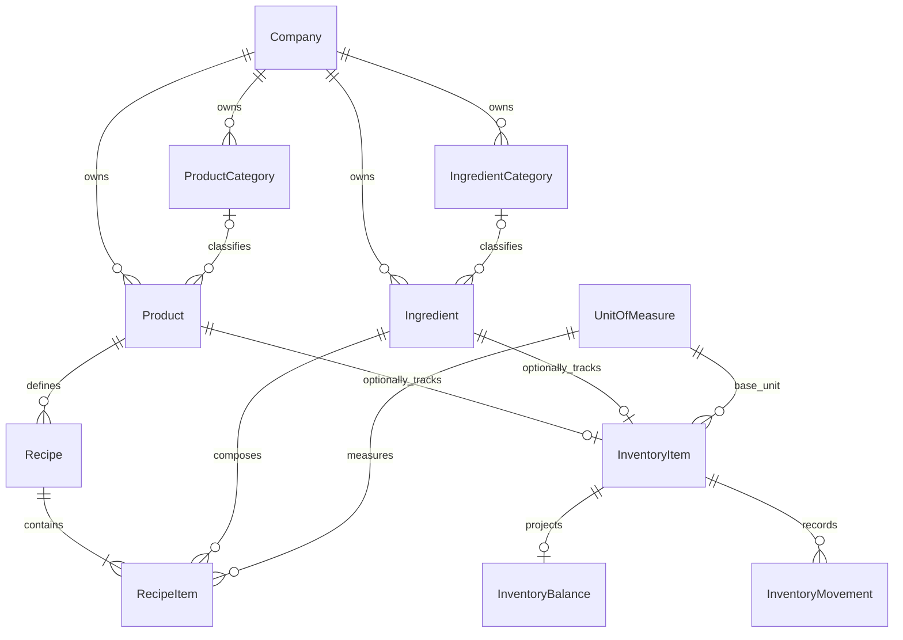

# PULSO — Sprint 2: camada operacional

- **Status:** proposta de discovery e planejamento; aguarda aprovação humana do produto, das regras e dos ADRs. Nenhuma funcionalidade foi implementada.
- **Data:** 2026-11-09
- **Base:** escopo autorizado para planejamento pelo Founder/CTO em 2026-11-09; documentação do repositório e revisões read-only de Product Manager/Owner, Business Analyst, Architect/Database, UX/UI, Backend, Frontend, QA, Security e DevOps/SRE.
- **PRD relacionado:** [`docs/product/prd.md`](../product/prd.md), status Proposed.
- **Gate:** a autorização recebida permite discovery e planejamento somente; não aprova regras de negócio, prioridades, ADRs, migrations ou início da implementação.
- **Nota de contexto:** `README.md` ainda descreve o projeto como Sprint 0. Para este plano, prevalece o pedido explícito de início da Sprint 2; alinhar a documentação de status do projeto depois da aprovação.

## 1. Escopo fechado proposto

### Incluído na proposta de MVP (pendente de aprovação)

- Categorias independentes para produtos e ingredientes.
- Cadastro, consulta, edição e arquivamento de produtos comercializados e ingredientes/insumos, sempre pertencentes a uma única empresa.
- Cadastro de receitas/fichas técnicas que associam um produto a ingredientes e quantidades com unidades compatíveis.
- Estoque operacional com movimentos manuais rastreáveis e alerta consultável de estoque mínimo.
- Isolamento multi-tenant na API e nas relações do banco; valores e cálculos operacionais são responsabilidade do backend.
- Preparação de um ponto de integração para futura origem de movimentos, sem incluir integração com vendas nesta sprint.

### Exclusões propostas / pontos a confirmar

- Integração POS/vendas, baixa automática por venda ou consumo, fluxo de compras/fornecedores, lotes, múltiplos locais de estoque e transferências. O usuário pediu discovery de compra/recebimento, perdas/desperdícios e controle físico; nenhum desses processos foi validado com operadores. Confirmar se uma entrada manual de estoque basta para recebimento simples, se perdas/contagens físicas fazem parte do MVP e manter os demais fora até decisão explícita.
- Notificações externas, automações, IA, analytics avançado, previsão de demanda, custos de mão de obra, perdas teóricas ou margens/preços sugeridos.
- Compartilhamento de um saldo entre produto comercial e ingrediente.
- Ingestão de dados por integrações externas.

### Limite de aprovação

O escopo acima é uma proposta para discussão, não um escopo de produto aprovado. Os papéis especializados fizeram revisão documental; **não houve validação com operadores de restaurantes**. As regras marcadas como pendentes bloqueiam o aceite dos comportamentos afetados. O responsável pelo produto deve aprovar escopo, prioridades e regras; o Founder/CTO deve aceitar os ADRs, após revisão técnica, antes de implementação. Nenhuma migration deve ser criada ou aplicada antes dessa aprovação.

## 2. Entregas 2.1, 2.2 e 2.3

| Etapa | Entrega proposta | Dependências | Prioridade |
|---|---|---|---|
| **2.1 — Cadastros e unidades** | Categorias de produtos e ingredientes; cadastro de Product e Ingredient; consulta, edição e arquivamento; definir catálogo controlado inicial de unidades e unidades-base sem ainda movimentar estoque. | Autenticação e Membership existentes; decisões de campos, duplicidade, unidades e permissões. | P0 — base de dados reutilizável. |
| **2.2 — Receitas e fichas técnicas** | Receita associada a produto, com componentes Ingredient, quantidade e unidade compatível; consulta e edição/versionamento conforme regra aprovada. Cálculo de custo é uma decisão/proposta técnica, não requisito MVP por padrão. | 2.1; decisões de rendimento, unidade, publicação/versionamento e política de custo. | P1 — depende dos cadastros. |
| **2.3 — Estoque e alertas** | Configurar estoque independente por Product ou Ingredient; unidade-base e mínimo conforme regra aprovada; movimentos manuais imutáveis; saldo consistente e alerta interno consultável. Contagem/reconciliação física depende de decisão de escopo. | 2.1 e decisões de itens controlados, unidade, saldo, movimentos, concorrência, precisão e mínimo. Não depende de Sales. | P1 proposto — depende da definição operacional do saldo. |

As prioridades P0/P1 são recomendação para discussão, não prioridade de produto
aprovada. A capacidade e duração da sprint não foram fornecidas.

Cada etapa requer critérios de aceite aprovados, testes de isolamento e migration versionada e revisada. A etapa seguinte não deve compensar decisões de domínio pendentes com defaults ocultos.

## 3. Modelo de domínio proposto

- **ProductCategory / IngredientCategory:** classificações separadas por tenant; arquivar em vez de apagar quando referenciadas.
- **Product:** item comercializável da empresa. Não é sinônimo de ingrediente nem prova de que haja estoque controlado.
- **Ingredient:** insumo usado em receita; pode ter estoque próprio.
- **UnitOfMeasure:** catálogo controlado de unidades e dimensões. Valores operacionais persistidos como decimal exato; conversão apenas dentro da mesma dimensão no MVP. Proposta: referência global controlada, sem `companyId`; confirmar como exceção às entidades operacionais tenant-owned.
- **Recipe:** ficha técnica associada a um produto. Uma ficha publicada deve preservar a composição histórica; edição passa por nova versão/draft, se essa regra for aprovada.
- **RecipeItem:** componente de receita; referencia Ingredient da mesma empresa, quantidade positiva e unidade conversível para a unidade-base do ingrediente.
- **InventoryItem:** identidade comum do controle de estoque, associada a exatamente um Product ou Ingredient; saldo de produto e ingrediente nunca compartilhado.
- **InventoryBalance:** projeção do saldo atual por InventoryItem, atualizada na mesma transação que o ledger.
- **InventoryMovement:** ledger append-only de entrada, saída, ajuste e reversão; contém quantidade assinada gerada pelo backend, unidade-base, data, ator e motivo/idempotency key quando aplicável.
- **Company:** toda entidade operacional pertencente a uma empresa carrega `companyId`. IDs tenant-scoped são referenciados por chaves estrangeiras compostas `(companyId, id)` para impedir relações entre empresas distintas no banco, além da validação no serviço. Catálogos de referência globais, como UnitOfMeasure, são uma exceção proposta e precisam de decisão explícita.

Os nomes dos campos, tipos e constraints são contrato de implementação a confirmar no refinamento técnico. A proposta mantém o padrão atual de IDs `String` UUID e timestamps do Prisma.

### Diagrama ER proposto

### Isolamento e autorização

Todas as rotas seguem `/companies/:companyId/...` e aplicam `JwtAuthGuard` + `CompanyMembershipGuard`, que verifica Membership persistida para a identidade autenticada. `companyId` não é aceito em DTO como prova de autorização; listas, leituras e mutações também filtram pelo tenant no serviço. Toda FK entre entidades operacionais usa o mesmo `companyId`. A resposta para recurso inacessível deve seguir o comportamento seguro já usado pela API, sem revelar existência em outro tenant.

Papéis `OWNER`, `ADMIN` e `MEMBER` existem, mas as permissões atuais de Membership/convites não definem autorização operacional. Matriz de leitura, criação, edição, arquivamento, publicação e movimento precisa de aprovação do responsável pelo produto; não presumir permissões novas.

## 4. Decisões arquiteturais e ADRs

ADR significa proposta técnica; todos os documentos abaixo devem permanecer **Proposed** até aprovação:

1. [`0001-tenant-scoped-catalog-and-stock-identity.md`](../architecture/decisions/0001-tenant-scoped-catalog-and-stock-identity.md) — Product e Ingredient são distintos; InventoryItem dá identidade comum ao ledger, com saldos separados e constraint XOR.
2. [`0002-measurement-units-and-exact-conversions.md`](../architecture/decisions/0002-measurement-units-and-exact-conversions.md) — unidades controladas, dimensões e conversões racionais exatas dentro da dimensão.
3. [`0003-inventory-ledger-and-balance-consistency.md`](../architecture/decisions/0003-inventory-ledger-and-balance-consistency.md) — ledger append-only, reversão por evento, saldo projetado transacionalmente, concorrência e idempotência.
4. [`0004-recipe-versioning-and-cost-semantics.md`](../architecture/decisions/0004-recipe-versioning-and-cost-semantics.md) — versões de ficha e delimitação do cálculo de custo; custo computado fica fora do MVP até aprovação da política de negócio.
5. [`0005-currency-and-monetary-precision.md`](../architecture/decisions/0005-currency-and-monetary-precision.md) — decimais exatos, moeda, escala e arredondamento; escolha de custo médio/FIFO e backfill da moeda dependem do responsável.

### Opções técnicas propostas

- Quantidades e dinheiro: PostgreSQL `NUMERIC` / Prisma `Decimal`, nunca `float`/`number` para aritmética. Contratos REST aceitam decimais em string; precisão, escala e arredondamento são pendentes.
- Conversões: fatores racionais numerador/denominador, unidade canônica por dimensão e conversões apenas massa↔massa, volume↔volume ou contagem↔contagem. Conversão massa-volume por densidade fica fora do MVP.
- Custo de ficha, se aprovado: quantidade convertida × custo unitário do ingrediente, somado por composição e dividido pelo rendimento. Opções para custo unitário: custo médio ponderado ou FIFO; recomendação provisória é custo médio ponderado por simplicidade. A escolha e o caráter atual vs. snapshot precisam de decisão; custo não é preço de venda nem custo contábil completo.
- Histórico: movimento não pode ser editado ou apagado. Correções geram reversão e novo movimento; escopo de reversão parcial precisa de definição.
- Consistência: saldo e ledger gravados na mesma transação; serialização por item (lock de saldo ou atualização condicional), chave idempotente por tenant e constraint para impedir duplicidade. Se estoque negativo for proibido, validar atomicamente e no banco.
- Alertas: endpoint calcula a condição sobre saldo e mínimo (saldo `<=` mínimo), sem entidade de alerta/notification inicialmente. Persistência, deduplicação, canais, limiar e semântica de resolução exigem aprovação.
- Integridade: constraints de tenant compostas, unicidade tenant-scoped para nomes/códigos conforme regra de normalização, check de quantidades positivas, e check XOR Product/Ingredient em InventoryItem. Regras não suportadas pelo schema Prisma podem exigir SQL manual em migration.

## 5. Endpoints planejados

Contratos preliminares, não implementados nem aprovados. Todas as rotas protegidas por autenticação e Membership:

| Método e rota | Uso proposto |
|---|---|
| `GET/POST /companies/:companyId/product-categories` | Listar/criar categorias de produtos. |
| `GET/PATCH /companies/:companyId/product-categories/:categoryId` | Consultar/editar categoria; `POST .../:categoryId/archive` (ou PATCH de status) arquiva. |
| `GET/POST /companies/:companyId/products` | Listar/criar produtos com filtros/paginação acordados. |
| `GET/PATCH /companies/:companyId/products/:productId` | Consultar/editar; arquivar sem apagar referências. |
| `GET/POST /companies/:companyId/ingredient-categories` | Listar/criar categorias de ingredientes. |
| `GET/PATCH /companies/:companyId/ingredient-categories/:categoryId` | Consultar/editar; arquivar sem apagar referências. |
| `GET/POST /companies/:companyId/ingredients` | Listar/criar ingredientes. |
| `GET/PATCH /companies/:companyId/ingredients/:ingredientId` | Consultar/editar; arquivar sem apagar histórico. |
| `GET/POST /companies/:companyId/products/:productId/recipes` | Listar versões/criar ficha para produto. |
| `GET/PATCH /companies/:companyId/recipes/:recipeId` | Consultar/editar draft; publicação/versionamento é endpoint separado após regra aprovada. |
| `GET /companies/:companyId/inventory-items` | Consultar itens controlados e saldos. |
| `POST /companies/:companyId/inventory-items` | Configurar controle de estoque para exatamente um Product ou Ingredient; criação e unidade-base ainda dependem de aprovação. |
| `GET/PATCH /companies/:companyId/inventory-items/:itemId/settings` | Consultar/configurar mínimo e parâmetros operacionais aprovados, sem alterar silenciosamente histórico ou unidade-base. |
| `GET/POST /companies/:companyId/inventory-items/:itemId/movements` | Consultar ledger/criar movimento manual, com idempotency key. |
| `GET /companies/:companyId/stock/alerts` | Listar itens que atendem ao limiar aprovado. |
| `GET /companies/:companyId/units` | Consultar catálogo controlado de unidades; confirmar se referência é global ou tenant-owned. |

DTOs usam whitelist/validação estrita, UUIDs, decimais em string, enum de unidade e quantidades positivas. Nenhum endpoint de remoção física de movimento. Campos e status finais de erro devem seguir as regras aprovadas e padrões existentes de DTO, Swagger e NestJS.

## 6. Histórias e critérios de aceitação propostos

Os critérios são propostas observáveis, pendentes de validação do Product Owner.

### H1 — Manter catálogo (2.1)

**Como membro autorizado, quero cadastrar e organizar produtos e ingredientes da minha empresa para reutilizá-los na operação.**

- Dado payload válido, criar e consultar item/categoria sob a empresa autorizada.
- Editar altera somente campos permitidos e preserva referências.
- Duplicidade respeita regra aprovada e é consistente para concorrência.
- Item arquivado não aparece em seleções de novas receitas/movimentos; leituras históricas permanecem.
- Rejeitar campos inválidos, IDs de outro tenant ou categoria incompatível; acesso por empresa não-membro é negado sem vazamento.
- A política de remoção/arquivamento deve ser explícita antes da aceitação.

### H2 — Manter ficha técnica (2.2)

**Como membro autorizado, quero associar ingredientes e quantidades a um produto para padronizar sua composição.**

- Criar/consultar ficha com referências da mesma empresa e quantidade positiva.
- Rejeitar ingrediente externo, arquivado ou unidade não conversível conforme política aprovada.
- Edição de ficha publicada não altera silenciosamente seu histórico; versionamento/status precisam de regra aprovada.
- Se custo for aprovado, cálculo deve usar a política de custo e rendimento definida, valores exatos e arredondamento explícito; caso contrário, custo não é exibido no MVP.

### H3 — Controlar estoque (2.3)

**Como membro autorizado, quero registrar movimentos e consultar saldo para acompanhar os insumos e produtos controlados.**

- Movimento válido cria evento no histórico e atualiza saldo atomicamente.
- Cliente não escolhe sinal; tipo determina entrada/saída no backend.
- Repetição idempotente não duplica movimento; concorrência não perde atualizações.
- Falha de saldo/regra não deixa gravação parcial; política de saldo negativo deve ser aprovada.
- Movimento não pode ser apagado/editado; correção deixa histórico referenciável.
- Item com saldo igual/abaixo do mínimo aparece no alerta conforme limiar e comportamento aprovados.

### H4 — Preservar limites de empresa (todas as etapas)

**Como usuário de uma empresa, quero acessar apenas os registros autorizados da empresa atual.**

- A API deriva a identidade do JWT e verifica Membership persistida a cada requisição.
- Leituras e escritas da empresa A não retornam nem alteram dados da empresa B.
- FK de categoria, produto, ingrediente, receita e estoque de outra empresa é recusada pelo serviço e protegida por constraint no banco.
- O frontend não é considerado mecanismo de autorização.

### Casos de erro transversais

Não autenticado (401); sem Membership ou recurso de outra empresa (negação segura conforme padrão existente); papel sem permissão; 400 para validação/formato; conflito para duplicidade/concorrência/saldo incompatível conforme API aprovada; entidade arquivada; unidade incompatível; movimento repetido tratado idempotentemente. Respostas não devem incluir dados de outro tenant ou deixar alterações parciais.

## 7. Estratégia de testes

- **Unitário (Vitest):** validação e regras de domínio, conversões exatas, fórmulas de custo somente se aprovadas, semântica de movimento e mapeamento de erros. Mocks não bastam para validar concorrência ou constraints.
- **Integração (NestJS/Prisma/PostgreSQL):** CRUD, unicidade, FK composta, constraints XOR, transações, movimentos e saldo concorrente; verificar rollback sem parcialidade. Dados isolados por teste.
- **E2E (Supertest):** dois tenants e usuários/memberships; fluxos autorizados em A e tentativas de leitura/escrita/referência cruzada em B. Asserções de status e payload, incluindo ausência de vazamento.
- **Frontend:** quando ferramenta for adicionada/aprovada, testar estados vazio/carregamento/erro, formulários, filtros e acessibilidade; teste de UI nunca substitui isolamento no backend.
- **Regressão/qualidade:** manter testes existentes de autenticação e Membership; typecheck, lint e build; executar E2E com PostgreSQL local disponível.

**Evidência futura:** relatório deve registrar comando executado, resultado e contagem. Nenhum teste foi executado nesta etapa de planejamento.

## 8. Dependências entre tarefas

1. Aprovar decisões de produto transversais (permissões, ciclo de vida, unidades, precisão e escopo do estoque).
2. Refinar schema de categorias/Product/Ingredient e contratos de API — 2.1.
3. Aprovar modelagem de unidades, implementar e validar 2.1; publicar contratos tipados para a UI.
4. Definir regras de receita/rendimento e versionamento; implementar Recipe/RecipeItem e testes — 2.2.
5. Definir tipos de movimento, saldo negativo, mínimo, reversão, custo e estratégia de lock/idempotência; então implementar InventoryItem, saldo, ledger, alertas — 2.3.
6. Desenvolver UI por contratos aprovados e cobrir estados de sucesso/erro. Não paralelizar tarefas que editam o mesmo schema, contrato ou migration.
7. QA roda isolamento, invariantes de domínio, fluxo e regressão por etapa; etapa não é aceita apenas por build.

## 9. Complexidade estimada

Estimativa preliminar de engenharia, sem velocidade histórica fornecida; inclui backend, frontend e validação básica, exclui decisões demoradas/rollout. Incerteza de ±40%:

| Etapa | Complexidade | Faixa indicativa |
|---|---|---:|
| 2.1 — Cadastros/unidades | M | 5–8 pessoa-dias |
| 2.2 — Receitas/fichas | L | 7–11 pessoa-dias |
| 2.3 — Estoque/ledger/alertas | XL | 10–16 pessoa-dias |
| Integração, revisão e regressão | L | 4–7 pessoa-dias |

**Total indicativo:** 26–42 pessoa-dias, uma vez aprovadas as regras. Concorrência do ledger, conversões, custo e autorização por papel são as maiores fontes de variação. Reestimar após decisões e refinamento de endpoints.

Esta faixa é estimativa de esforço, não compromisso de calendário ou garantia
de caber em uma sprint. Não há histórico de velocidade/capacidade aprovado; o
Founder/CTO deve confirmar duração, disponibilidade e metas antes do
planejamento de execução.

## 10. Riscos técnicos e de produto

- **Tenant leakage:** mitigado por guard existente, filtros explícitos e FKs compostas em todas as referências operacionais; precisa de testes E2E por tenant.
- **Saldo divergente:** ledger e projeção em transações, lock/atualização condicional, idempotência, constraint e reconciliação.
- **Unidade ambígua:** não converter dimensões diferentes sem dado específico; custo/saldo sem unidade canônica é inválido.
- **Custo inconsistente:** precisão, moeda e custo corrente vs. snapshot precisam de regra antes de exibir ou persistir valor.
- **Histórico apagado:** sem delete/update de movimentos; correções via reversão. Trigger de banco para imutabilidade forte requer revisão de manutenção.
- **Escopo de vendas antecipado:** estoque não fará baixa automática nem depende do módulo Sales; futura origem de venda precisa de idempotência e semântica de momento de consumo.
- **Migrations para base existente:** adicionar moeda obrigatória ou constraints não-nulas exige backfill/estratégia expand-contract. Nunca executar migration destrutiva nem reset.
- **Permissões indefinidas:** papéis existentes não definem autorização operacional; endpoint pode ser seguro contra tenant leakage e ainda assim não ter política de negócio aprovada.
- **Experiência de uso:** o frontend não tem design system/testes identificados; formulário de receita/estoque depende de contratos tipados e decisões UX.

## 11. Critérios de conclusão da Sprint 2

- Escopo, prioridade, histórias, matriz de papéis, comportamento de unidades/receita/estoque e critérios de aceite aprovados pelo responsável do produto.
- ADRs relevantes aceitos pelo responsável técnico; nenhuma proposta é tratada como aceita antes disso.
- Migrations versionadas, aditivas e revisadas; constraints e índices cobrem tenant, duplicidade, quantidade e consistência; nenhum dado histórico é apagado.
- Todas as entidades operacionais respeitam tenant em serviço e banco; nenhuma rota confia em `companyId` do cliente sem Membership.
- CRUDs, receitas, movimentos e alertas implementados conforme critérios aprovados, com erros explícitos e histórico preservado.
- Valores usam precisão decimal apropriada; conversões/custos (se aprovados) têm regra e testes determinísticos.
- Testes unitários, integração, E2E de isolamento e concorrência executados e reportados sem falsos positivos; regressões de auth/Membership continuam aprovadas.
- Frontend substitui o template inicial por layout PULSO coerente, acessível, responsivo e integrado aos contratos aprovados.
- Typecheck, lint, build e suites relevantes executados; documentação atualizada; riscos remanescentes aceitos explicitamente.
- Nenhum componente de IA ou integração de Sales da Sprint 3 foi iniciado.

## 12. Divergências e decisões para aprovação humana

### Divergências entre propostas

- **Sequência dos cadastros:** PM e Arquitetura agrupam categorias, produtos e ingredientes em 2.1; a proposta de Frontend colocou ingredientes em 2.2 junto a receitas. Este planejamento consolida todos os cadastros em **2.1**, pois receita depende de ingredientes.
- **Custo de receitas:** PM recomenda não incluir cálculo de custo no MVP sem validação; Arquitetura propõe fórmula e alternativas de custo médio/FIFO; PO também deixou custo em aberto. Decisão consolidada: **cálculo e exibição de custo fora do MVP até aprovação**, sem impedir ADR de registrar opções.
- **Alertas:** proposta de produto sugere alerta interno; Arquitetura propõe consulta calculada no backend sem entidade persistida ou notificação. Consolidado no MVP proposto como endpoint/lista interna calculada, sem push/e-mail; limiar e resolução continuam pendentes.
- **Handoff Backend/PO:** os relatórios desses papéis informaram não ter recebido/identificado os pareceres prévios, apesar da solicitação de contexto. Assim, as propostas deles não validam integralmente os pareceres anteriores; endpoints/modelo foram sintetizados neste documento a partir do schema existente e do relatório de Arquitetura.

### Aprovações necessárias do responsável pelo produto

1. Confirmar MVP, prioridades e divisão 2.1–2.3, inclusive se catálogo de produtos e de ingredientes é separado.
2. Definir campos obrigatórios, regra de duplicidade, reutilização de nomes/SKUs, arquivamento e permissões por papel.
3. Aprovar unidades, conversões, precisão/escala, arredondamento e se cada empresa tem moeda-base.
4. Definir relação de Product/Ingredient com estoque: quais são controlados e se estoque negativo é permitido.
5. Definir semântica e tipos de movimento, ajuste, reversão parcial/integral e autoria.
6. Definir mínimo e condição de alerta (igual ou menor), estados/resolução e se é apenas visual ou notificado.
7. Definir se receita tem rendimento/porções, drafts/publicação/versionamento e como alterações afetam referências históricas.
8. Decidir se custo de receita entra no MVP; se sim, escolher custo médio ponderado/FIFO, custo atual/snapshot, moeda, arredondamento e componentes incluídos.
9. Confirmar explicitamente que não haverá baixa automática por venda nesta sprint e manter integração de Sales para Sprint 3.

**Sem essas aprovações, o documento é orientação para revisão, não autorização para implementação.**

---

## 13. Discovery de processos operacionais

**Limite da análise:** as revisões foram documentais. Nenhum operador de
restaurante foi entrevistado ou observado; os fluxos seguintes são hipóteses
para discovery, não processos reais validados.

| Processo | O que está documentado | Descoberta necessária |
|---|---|---|
| Catálogo | A proposta separa produtos comercializáveis, ingredientes e categorias; campos e duplicidade não estão definidos. | Quem mantém cada catálogo? Quais campos, códigos, nomes, categorias e unidades são usados? Nome/código pode ser repetido? O que ocorre com itens referenciados quando arquivados? |
| Compra/recebimento | Compras e fornecedores estão fora do MVP proposto; uma entrada manual é considerada, mas não cobre um fluxo de compra. | É suficiente registrar entrada manual? Há pedido, fornecedor, nota, recebimento parcial, conferência ou unidade de compra distinta? O que fazer com divergência ou devolução? |
| Receita/preparação | O plano cobre ficha técnica ligando produto a ingredientes. Preparação executada e consumo real não foram especificados. | A ficha é apenas documentação ou também registra produção/preparo? Há rendimento, porções, substituições ou sub-receitas? Alterar a ficha afeta produções anteriores? Baixa de estoque por preparo está ou não no escopo? |
| Perdas/desperdícios | Perdas teóricas estão fora; tipos/motivos de movimento ainda precisam de decisão. | Quais eventos são perda real (vencimento, quebra, sobra, erro de contagem)? Como diferenciar perda, ajuste e saída? Quem registra e aprova? |
| Controle físico | O plano propõe saldo e ledger, mas não descreve contagem física ou reconciliação. | Inventário total ou cíclico? Frequência e papéis? Como registrar saldo inicial e divergência? O sistema deve propor um ajuste ou exigir aprovação? |

**Impacto por etapa:** 2.1 depende de campos, unidades e ciclo de vida do
catálogo; 2.2 depende de validar se o produto cobre ficha ou preparo real e de
decidir rendimento/versionamento; 2.3 depende de recebimento, perdas,
contagem/reconciliação, tipo de movimento, saldo negativo e alertas. Compras e
fornecedores seguem propostos fora do MVP até decisão explícita. Não incluir
recebimento, perdas ou contagem física como regra implícita.

## 14. Requisitos e indicadores propostos

### Requisitos funcionais

- **RF-01:** manter categorias, produtos e ingredientes isolados por empresa,
  com ciclo de vida e regras de duplicidade a aprovar.
- **RF-02:** validar unidades e conversões aceitas; persistir quantidades sem
  ponto flutuante impreciso.
- **RF-03:** criar e consultar fichas técnicas para produtos e ingredientes
  elegíveis, preservando histórico segundo regra aprovada.
- **RF-04:** habilitar estoque para uma identidade de produto ou ingrediente,
  mantendo saldos distintos e consultáveis.
- **RF-05:** registrar e consultar movimentos manuais conforme tipos, motivo,
  autoria e correção aprovados; não editar/apagar histórico.
- **RF-06:** consultar itens cujo saldo satisfaz a regra de mínimo aprovada.
- **RF-07:** autorizar cada operação no backend com Membership persistida e
  escopo de tenant; rejeitar referências cross-tenant na API e no banco.

### Requisitos não funcionais

- Decimal exato (`NUMERIC`/`Prisma.Decimal`); REST transporta decimais como
  strings. Escala, limites e arredondamento precisam de decisão.
- Escritas correlatas de movimento/saldo e receita/componentes são atômicas;
  concorrência e idempotência têm cobertura com PostgreSQL real.
- Erros explícitos, validação estrita, sem vazamento cross-tenant e sem logs de
  segredos ou dados operacionais sensíveis.
- UI acessível/responsiva com estados vazio, carregando, sucesso e erro;
  substituir a experiência inicial do Vite antes da conclusão futura da sprint.
- Migrations versionadas, aditivas por padrão e revisadas; nenhum reset,
  migration destrutiva ou deploy autorizado por este plano.

### Indicadores sem metas inventadas

Medir após definição de baseline, janela e privacidade: conclusão de cadastro,
fichas consultadas, movimentos aceitos/recusados, discrepâncias ledger-saldo,
itens em alerta e tentativas cross-tenant bloqueadas. **Não há metas numéricas,
instrumentação nem baseline aprovados.** Não alegar ganho operacional antes de
validar fluxos e medidas com usuários.

## 15. Especificação UX/UI

O frontend atual ainda é o starter do Vite e não foi identificado design system
aprovado. A direção seguinte é proposta, não branding aprovado:

- Navegação operacional por **Produtos**, **Ingredientes**, **Receitas** e
  **Estoque**, com empresa/contexto atual explícito; em telas menores, menu
  responsivo.
- Rotas candidatas: `/companies/:companyId/products`,
  `/companies/:companyId/ingredients`, `/companies/:companyId/recipes`,
  `/companies/:companyId/recipes/:recipeId`,
  `/companies/:companyId/inventory` e
  `/companies/:companyId/inventory/alerts`.
- Produtos e ingredientes têm listas independentes, busca/filtros, detalhe e
  formulários; uma categoria/unidade só é mostrada quando definida pelo
  contrato.
- Receita tem editor de componentes por linha (ingrediente, quantidade,
  unidade) e versão/status apenas quando aprovados. Não exibir custo sem
  política de custo aprovada.
- Estoque distingue identidade do item, unidade, saldo e movimentos; entrada,
  saída, ajuste e reversão são ações distintas quando aprovadas. Não oferecer
  edição/apagamento de movimento.
- Em cada página, distinguir vazio inicial de filtro sem resultado; loading
  com skeleton; erro com ação de retry e dados digitados preservados; validação
  junto ao campo; sucesso sem duplicar gravação.
- Acessibilidade: navegação por teclado, foco visível, labels persistentes,
  erros anunciados, contraste adequado, ícones acompanhados por rótulo,
  alertas não dependentes somente de cor, tabelas responsivas.
- Propor tokens visuais neutros e identidade PULSO própria após validação com o
  Founder/usuários. Não declarar identidade/design system existente e remover
  logos/links/textos do template Vite antes do aceite da experiência.

Validação pendente com operadores: dispositivo/contexto de uso, nomes e
campos úteis, rotina de entrada/perda/contagem, prioridade dos alertas e
necessidade real de rendimento da receita.

## 16. Limites de módulos e contratos de API

### Módulos candidatos

- `CatalogModule`: categorias, produtos e ingredientes.
- `UnitsModule`: catálogo de referência e conversões.
- `RecipesModule`: ficha, itens, validação de composição e histórico.
- `InventoryModule`: configuração de item controlado, saldo, ledger, alertas.

Backend mantém regra de negócio, Membership, scoping e autorização; frontend
consome contratos tipados e não decide permissões. Unidades podem ser
referências globais enquanto registros operacionais são tenant-owned; esta
exceção ao modelo tenant precisa de aprovação. Não criar módulo Sales nem
baixa por venda nesta sprint.

### Lacunas a resolver nos endpoints

O catálogo atual do plano propõe `GET /inventory-items`, mas não descreve como
habilitar controle de estoque, associar Product ou Ingredient, definir mínimo
ou listar unidades. Propostas para refino:

- `POST /companies/:companyId/inventory-items`: associar exatamente um
  `productId` ou `ingredientId`; unidade-base e mínimo conforme decisões.
- `GET/PATCH /companies/:companyId/inventory-items/:itemId/settings`: obter e
  editar somente configurações permitidas, por exemplo o mínimo, sem alterar
  unidade histórica silenciosamente.
- `GET /companies/:companyId/units`: disponibilizar unidades aceitas se o
  catálogo for global; alternativa é endpoint global de leitura, decisão
  técnica pendente.

Esses endpoints complementam a tabela preliminar da seção 5; não são contratos
aprovados. DTOs devem omitir `companyId` como fonte de autorização, validar IDs
UUID, enums e campos desconhecidos, e usar decimal string. Movimento recebe
quantidade positiva e tipo; o backend deriva sinal. Definir paginação/filtros,
status/corpo de erros, idempotency key e resposta para chave repetida. Erro
cross-tenant deve manter comportamento seguro existente.

## 17. Plano futuro de implementação, tarefas e dependências

**Esta seção planeja trabalho futuro; não inicia tarefas nem atribui acesso de
escrita agora.** Responsáveis nominais e paths exclusivos devem ser registrados
no início de cada etapa após aprovação.

| Ordem | Tarefa futura | Owner de papel | Paths candidatos e limite | Dependência / evidência |
|---|---|---|---|---|
| 0 | Entrevistas e aprovação das regras, prioridade e Ready | PM, PO, BA; Founder aprova | PRD/plano; sem código | Evidência de processo e decisões bloqueadoras |
| 1 | Schema/constraints aditivos | Database Engineer | `apps/api/prisma/schema.prisma`, migration nova; exclusiva da etapa | ADRs aceitos; revisão e plano de dados/rollback |
| 2 | Catálogo, unidades e contratos 2.1 | Backend | módulos/DTOs/controllers operacionais e `packages/contracts`; não editar schema/migration em paralelo | Tarefa 1; testes de validação, tenant e duplicidade |
| 3 | UI base e cadastros 2.1 | Frontend/UX | `apps/web/src/**`; Backend não edita estes paths | Contratos 2.1 estáveis; critérios UX |
| 4 | Receitas 2.2 | Backend e Frontend em paths separados | `apps/api/src/recipes/**`, `apps/web/src/**`; migrations somente pelo owner DB | 2.1 aprovada; regras de unidade/rendimento/histórico |
| 5 | Ledger/saldo/alertas 2.3 | Backend e Database em paths separados | `apps/api/src/inventory/**`; schema/migrations pelo owner DB | regras de movimento/negativo/mínimo/idempotência aceitas |
| 6 | UI de estoque, movimentos e alertas | Frontend | `apps/web/src/**`, sem editar contratos/backend | endpoints aprovados e testes de contrato |
| 7 | Testes de aceitação/regressão | QA independente | specs de teste atribuídos sem editar código de implementação | critérios congelados por etapa |
| 8 | CI/observabilidade/validação operacional | DevOps/SRE | infraestrutura/workflows somente se aprovados | ambiente, retenção e release gates decididos |
| 9 | Revisão de segurança e arquitetura por etapa | Security/Architect, somente leitura | sem paths de implementação | diff estável; findings e evidência |

2.2 depende de 2.1; estoque e alertas dependem de identidade/unidades e
decisões 2.3, mas podem ser desenvolvidos em paralelo com receitas somente se
schema, contratos e owners de arquivo forem isolados e compartilhados por
handoff estável. Não paralelizar edições no mesmo schema, contrato ou migration.

## 18. Matriz de testes

Esta matriz é plano; nenhum teste operacional foi executado.

| Domínio | Unitário | Integração PostgreSQL/NestJS | E2E API (dois tenants) | UI/regressão |
|---|---|---|---|---|
| Catálogo 2.1 | Normalização/campos; estados | CRUD, índices/unicidade, referências | CRUD autorizado; ID/ref de outra empresa recusado | formulários, filtros, vazio/loading/erro, auth regressão |
| Arquivamento 2.1 | elegibilidade/estado | preservar referências e histórico | não selecionar arquivado para nova referência conforme regra | badge, confirmação, histórico acessível |
| Unidades 2.1/2.2 | fator racional, dimensão e limite | persistência/constraints de fatores e base | unidade compatível/incompatível | mensagens por campo; nunca arredondar silenciosamente |
| Receita 2.2 | quantidades, regra/rendimento se aprovado | criação atômica e histórico/versionamento | composição mesma empresa; referência cruzada recusada | editor de linhas, estado draft/publicado se adotado |
| Custo condicional | fórmula/rounding/moeda só se aprovada | persistência e snapshot conforme política | valor e origem consistentes | custo ausente se não aprovado; senão label/unidade |
| Movimentos/saldo 2.3 | tipo/sinal e regras | ledger+saldos atômicos; rollback, FK, concorrência, idempotência | repetição, saída concorrente, referência cross-tenant | formulário, confirmação, histórico imutável |
| Alertas 2.3 | fronteiras do limiar aprovado | consulta baseada em saldo mínimo | saldo abaixo/igual/acima e tenant scope | alerta não depende só de cor; vazio/erro |
| Segurança transversal | guards/policies isoláveis | FKs compostas e constraints | JWT, Membership, matriz de papéis, sem vazamento A/B | UX não substitui autorização backend |

Fixtures devem criar empresas A/B, memberships, dados operacionais por tenant e
IDs únicos. PostgreSQL real é obrigatório para constraints/transações e
concorrência; mocks não provam esses comportamentos. Configuração E2E existente
seleciona testes, mas requer PostgreSQL local. Escolha/aprovação de ferramenta
de teste UI está pendente. Preservar testes auth/Membership. QA só marca
critérios como passados após executar e registrar comando, resultado e
ambiente.

## 19. Matriz de riscos provisória

Classificação qualitativa, sujeita a revisão do Product Owner/Founder; não há
dados para probabilidade numérica.

| Risco | Impacto | Mitigação proposta | Owner futuro |
|---|---|---|---|
| Vazamento entre empresas por ID ou referência cruzada | Alto | Membership por requisição, scoping em cada query, FKs compostas, E2E A/B | Backend + Security |
| Matriz OWNER/ADMIN/MEMBER ausente | Alto / bloqueia Ready | Aprovar por ação antes dos endpoints | PO + Founder |
| Saldo divergente sob concorrência/retry | Alto | transação ledger+saldo, lock/atualização condicional, idempotência, teste real | Backend + Database + QA |
| Manipulação ou perda do histórico | Alto | ledger sem update/delete, reversão vinculada, política de retenção e acesso | Backend + Security |
| Unidade/precisão ambígua | Alto | unidade-base, Decimal/string, conversões explícitas, limite de escala | PO + Architect + Database |
| Recebimento, perdas e contagem mal representados | Alto de produto | entrevistas/workshop; não codificar equivalência entre entrada manual, perda e contagem | BA + PO |
| Migration bloqueante ou backfill incorreto | Alto | aditiva, revisar dados existentes, expand/contract, backup/rollback aprovados | Database + DevOps |
| Custo de receita incoerente | Médio/alto | fora do MVP por padrão; aprovar fórmula, moeda e snapshot antes de expor | PO + Database |
| Alertas sem tratamento operacional claro | Médio | aprovar limite, igualdade, resolução e canal antes de UX/API | PO + UX |
| CI/observabilidade insuficientes | Médio | decidir PostgreSQL CI, métricas/logs, acesso/retenção; validar antes de release | DevOps/SRE |
| UI assumir regra/permissão ou dificultar uso | Médio | backend autoritativo, pesquisa com usuários, critérios acessíveis | Frontend + UX |

## 20. Infraestrutura e operação (DevOps/SRE)

**Observado na revisão:** workspace pnpm; Compose local com PostgreSQL 16 e
Redis; scripts API para migration/status e suíte E2E dependente de PostgreSQL.
O endpoint de health verifica banco. Não foi identificada configuração CI no
repositório nem instrumentação observável completa; volumes locais não são
backup. Não foi avaliada produção.

**Critérios operacionais propostos, antes de futura release:**

- CI reproduzível executa lint/typecheck/build/testes e valida migration em
  PostgreSQL limpo e em upgrade sintético sem reset destrutivo.
- Estratégia de compatibilidade expand/contract, janela de backfill e rollback
  documentada; restore de backup ensaiado, responsáveis e RPO/RTO aprovados.
- Logs/métricas/traces com correlação, eventos auditáveis mínimos e alertas de
  falha/latência/consistência; sem segredo ou payload sensível.
- Ambiente E2E PostgreSQL isolado e concorrência testada; Redis só entra se
  necessidade operacional aprovada.
- Retenção, acesso aos logs e classificação de dados aprovados antes de dados
  de cliente/financeiros. Deploy e operações destrutivas exigem autorização
  humana específica.

## 21. Definition of Ready / Definition of Done específica

### Definition of Ready — Sprint 2

Uma etapa só entra em implementação quando:

1. PRD e prioridade dessa etapa estão aprovados pelo Founder/CTO; objetivo,
   inclusão/exclusão e usuários estão definidos.
2. Discovery necessário foi feito com operador/representante, ou a limitação
   foi explicitamente aceita sem afirmar validação.
3. Histórias, campos, estados, erros e critérios testáveis estão aprovados;
   nenhuma regra essencial está marcada pendente.
4. Matriz de permissões e tenant scope aprovados; Security threat model e
   critérios cross-tenant registrados.
5. ADRs aplicáveis aceitos e modelo/API/contratos revisados; decisão de unidade,
   Decimal, histórico, concorrência e migration pronta para a etapa.
6. Dependências, estimate/capacidade, owner, paths exclusivos e handoffs
   registrados; banco/CI necessários disponíveis.
7. QA registra matriz de testes, fixtures, infra, comandos e evidência
   esperados; DevOps registra migration/rollback/observabilidade quando
   aplicável.
8. Nenhuma dúvida de compra/recebimento, perdas ou inventário físico foi
   resolvida por default não aprovado.

### Definition of Done — cada etapa da Sprint 2

Uma etapa só é concluída quando todos os critérios aprovados daquela etapa
foram demonstrados e:

1. Implementação segue os contratos e regras aprovados; não amplia escopo.
2. Typecheck, lint, build e testes relevantes executaram com resultados
   registrados; testes de aceitação, regressão e isolamento passaram.
3. Segurança revisou mudanças de autenticação/autorização/tenant/dados; QA fez
   revisão independente. Nenhum autor aprova o próprio trabalho.
4. Migration aditiva revisada, integridade e impacto de dados documentados;
   rollback/backup aplicável revisado. Sem migration destrutiva não aprovada.
5. Erros, logs e métricas seguem políticas; documentação, contratos,
   OpenAPI/UI e ADRs atualizados.
6. Evidência inclui comando, resultado, diff estável, critérios verificados,
   riscos e pendências. Separar **Implementado**, **Testado**, **Revisado**,
   **Aprovado** e **Implantado**.
7. Nenhum P0/P1 permanece aberto sem aceitação explícita do Founder/CTO.

## 22. Gate de aprovação do Founder/CTO

Antes de liberar qualquer implementação, registrar decisões para:

- [ ] Aprovar PRD, objetivo mensurável, prioridades e divisão 2.1/2.2/2.3.
- [ ] Aprovar categorias/campos, duplicidade, arquivamento e papéis por ação.
- [ ] Confirmar se entrada manual cobre recebimento e se compras/fornecedores
  continuam fora.
- [ ] Confirmar se perdas/desperdícios e contagem/reconciliação física entram
  ou ficam fora do MVP.
- [ ] Definir se receita é somente ficha ou inclui preparo/consumo; rendimento,
  rascunho/publicação e versionamento.
- [ ] Aprovar catálogo, escopo tenant/global, conversões, escala e arredondamento
  das unidades.
- [ ] Definir itens controlados, configuração e unidade de estoque, saldo
  negativo, tipos/reversões/idempotência e autoria dos movimentos.
- [ ] Aprovar mínimo, regra de alerta, resolução e canal.
- [ ] Decidir custo de receita e, se entrar, método/moeda/snapshot/arredondamento.
- [ ] Aceitar ADRs técnicos aplicáveis e limites de dados, CI, backup,
  observabilidade e release.
- [ ] Confirmar explicitamente que Sales/POS, baixa automática e IA operacional
  não começam nesta sprint.

**Estado atual:** todos os itens permanecem pendentes. Nenhuma aprovação de
planejamento ou implementação é inferida por este documento.
